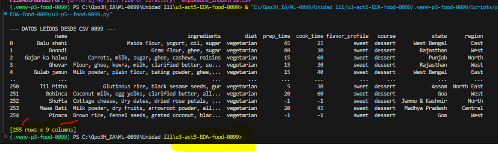
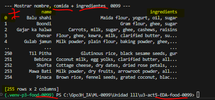
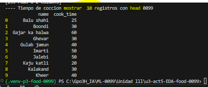
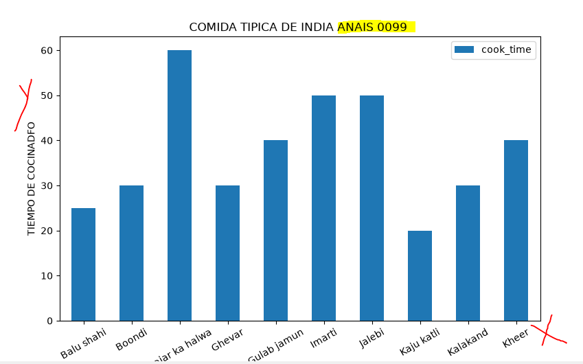
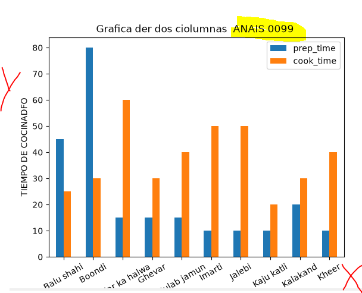
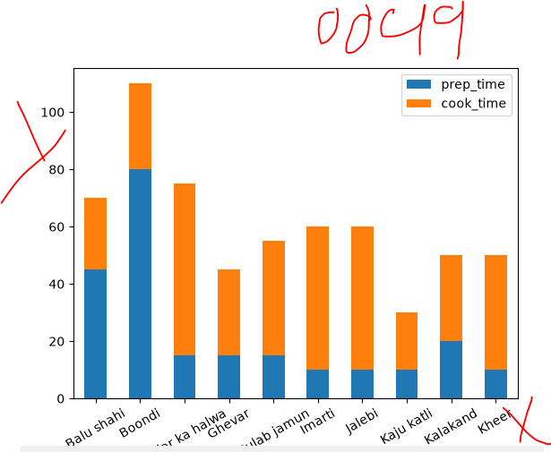

## Analisis exploratorio de datos 
## Comida del pais India
## Anais Medina NC 0099
### ---- importando datos del csv  comida de india

### ---- Mostrar nombre, comida + ingredientes 

### Tienpo de coccion mostrar  10 registros con head

### Garfica de comida de India 

### grafica de 2 columnas 

### graficas apiladas 

### 